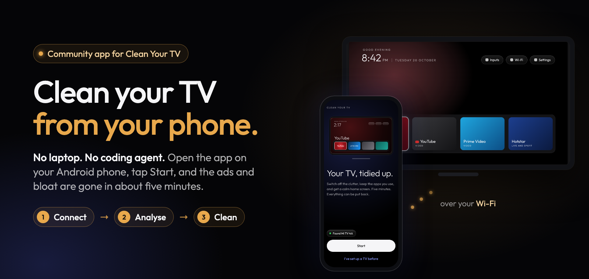
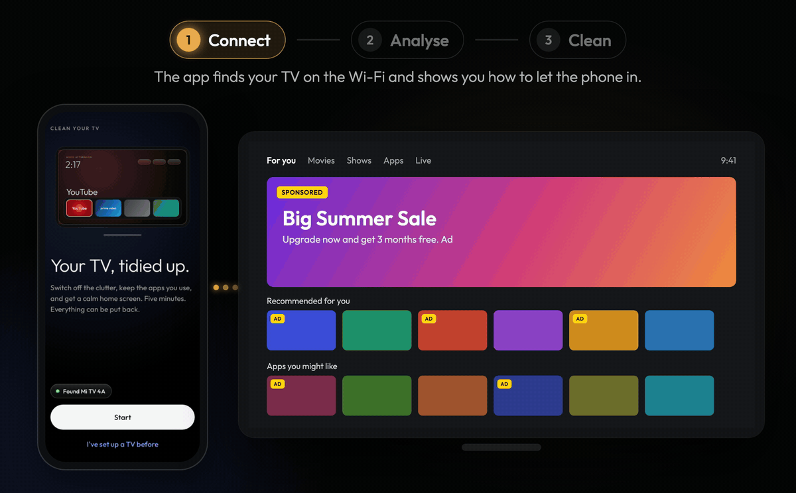
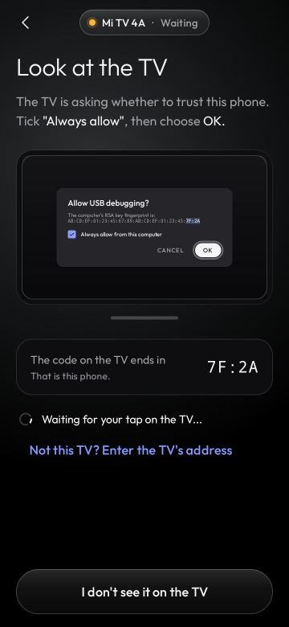
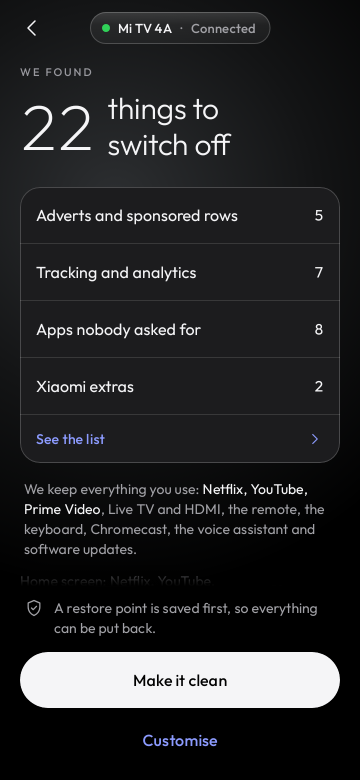
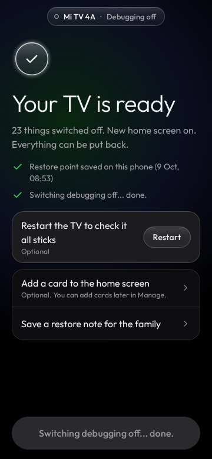

  

<h3 align="center">A community-built phone app for Clean Your TV. Anyone can clean up their TV: no laptop, no coding agent, no cables.</h3>

  

## How it works

| 1. Connect | 2. Analyse | 3. Clean |
| :-: | :-: | :-: |
|  |  |  |
| The app finds your TV on the Wi-Fi and shows you how to let the phone in with the remote. | It reads what is on the TV and shows the plan: what goes off and what stays. Nothing changes yet. | Tap "Make it clean". A restore point first, then the clutter goes and the new home screen comes on. |

**You need** an Android phone (Android 9 or newer, with a screen lock) on the same Wi-Fi as the TV.
[Download the APK] and open it to
install. Connecting takes about a minute (you switch on network debugging with the remote; the app
shows you how), and the whole clean-up about five minutes.

Come back any time to put an app back, check for leftovers after a TV update, change the dock or
the look, or undo everything.

## What your TV gets

Not every TV gets the new home screen yet. The app says which of these your TV gets before it
changes anything, on the "What we found" screen, and why.

| | Which TVs | What the app does |
| :- | :- | :- |
| **New home screen and clean-up** | TVs where testers confirmed the switch holds after a restart: most Xiaomi and Redmi sets on Android 9 to 11 and the Xiaomi MiTV-MZTU1 and MiTV-MOEU1 on Android 14; OnePlus on Android 11, Sony on Android 8, Hisense on Android 9, Homatics, MECOOL and the Strong LEAP-S1 on Android 14, the Toshiba Smart TV (hamamatsucho) on Android 11, the MI MiProjM05 projector on Android 9 (with Google's Android TV home); and the TCL, Sony, Hisense, Philips and other models whose list says so | Switches off the clutter and puts the Clean Your TV home screen in charge, with a restore point first |
| **Clean-up only, for now** | Most Google TV sets (their setup wizard holds the Wi-Fi, or the TV has no list yet), TVs the app has not met before, and Google's own Chromecast and TV Streamer (the switch would cost casting) | Switches off adverts, tracking and background apps. The TV keeps its own home screen, so it looks the same; the adverts drawn by that home screen stay with it |
| **Not possible** | Fire TV, TCL's China builds, Android 7 and older | Clean-up only, and the app says so up front |

The [TV list](https://udhaykumarbala.github.io/cleanyourtv-app/tvs/) says what each model gets today,
which ones are in the test build, and which are coming soon. A TV with no list of its own moves up
when its owners send its report from the app ("Help add this TV").

## Two ways to clean your TV

Clean Your TV gives any Android TV a calm, ad-free home
screen and switches off the bloat, using lists tested by its community. On its own it needs a
computer: you run its scripts, or hand its prompt to a coding agent. This app does the whole job
from your phone.

| | Clean Your TV repo | **Clean Your TV app** (this repo) |
| :- | :- | :- |
| **You need** | A computer with ADB, or a coding agent such as Claude Code | **Just an Android phone** on the same Wi-Fi as the TV |
| **You do** | Run the scripts, or give the prompt to the agent | **Tap Start, check the plan, tap "Make it clean"** |
| **Made for** | Tinkerers, themes and new TV lists | **Everyone**: you, your parents, your friends |

Both give you the same Clean Your TV home screen and the same community TV lists, switch apps off
without uninstalling them, and keep a way back for every change.

## Safe by design

- **You see every step.** Nothing runs until you have seen the plan, and Customise shows every
  command the app would send, in order.
- **Nothing is deleted.** Apps are switched off for the main user, so each one can come back. Wi-Fi,
  the Play Store, the remote, the TV's inputs and the parts Android needs are protected and never
  touched; accessibility, casting, voice and updates go off only if you choose.
- **Undo anything.** Put back one app or everything from the restore point. "Save a copy" exports
  plain restore scripts that work from any computer with adb, even without this app.
- **A watchdog on the TV.** If the phone does not confirm the new home screen within 150 seconds
  (the Wi-Fi drops, the phone dies), the TV puts its own home screen back by itself.
- **Careful where it counts.** On TVs where switching the home screen is known to cause trouble,
  the app does the clean-up only and tells you why.
- **Private.** No accounts, no analytics, no ads. The app talks to your TV and, only when you ask,
  to GitHub for updates. Network debugging is switched off again at the end unless you keep it on.

## Supported TVs

**173 TV lists from 47 brands**, from the Clean Your TV community lists: TCL, Sony, Xiaomi,
Hisense, Philips, Amazon Fire TV, Panasonic, XGIMI, BenQ, NVIDIA Shield, onn, Google and many more,
on Android TV, Google TV and Fire OS. A model nobody has listed yet still gets a careful clean-up
based on its brand.

